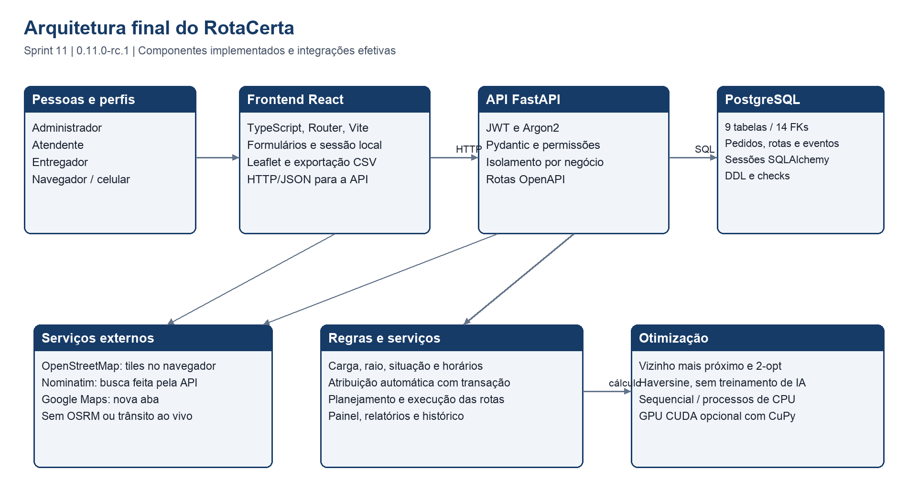
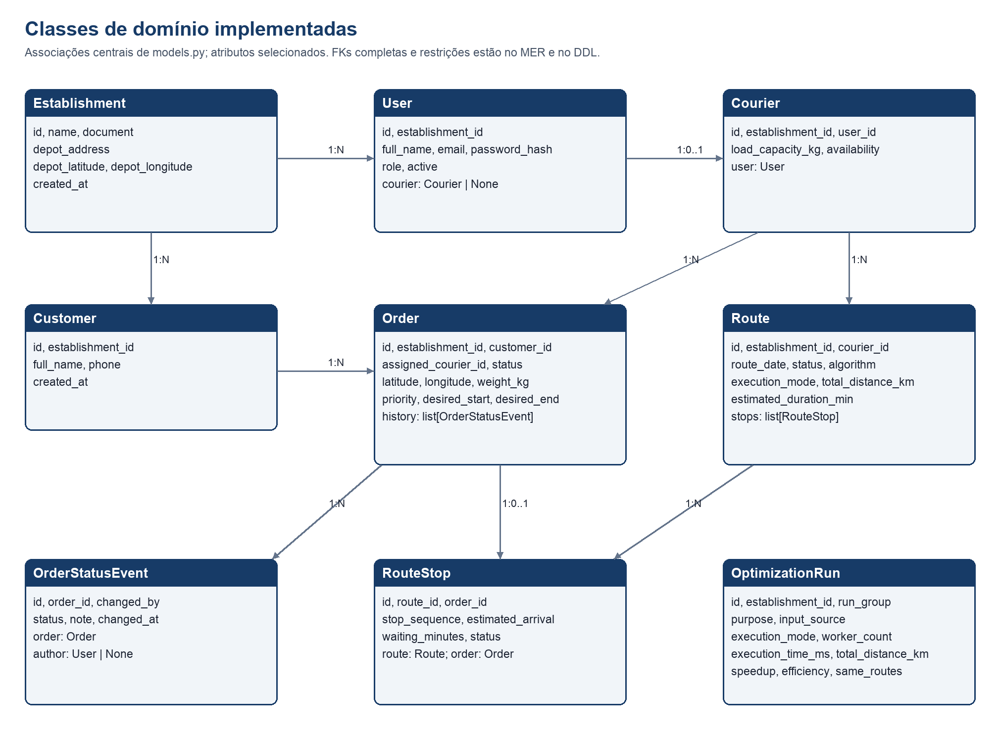
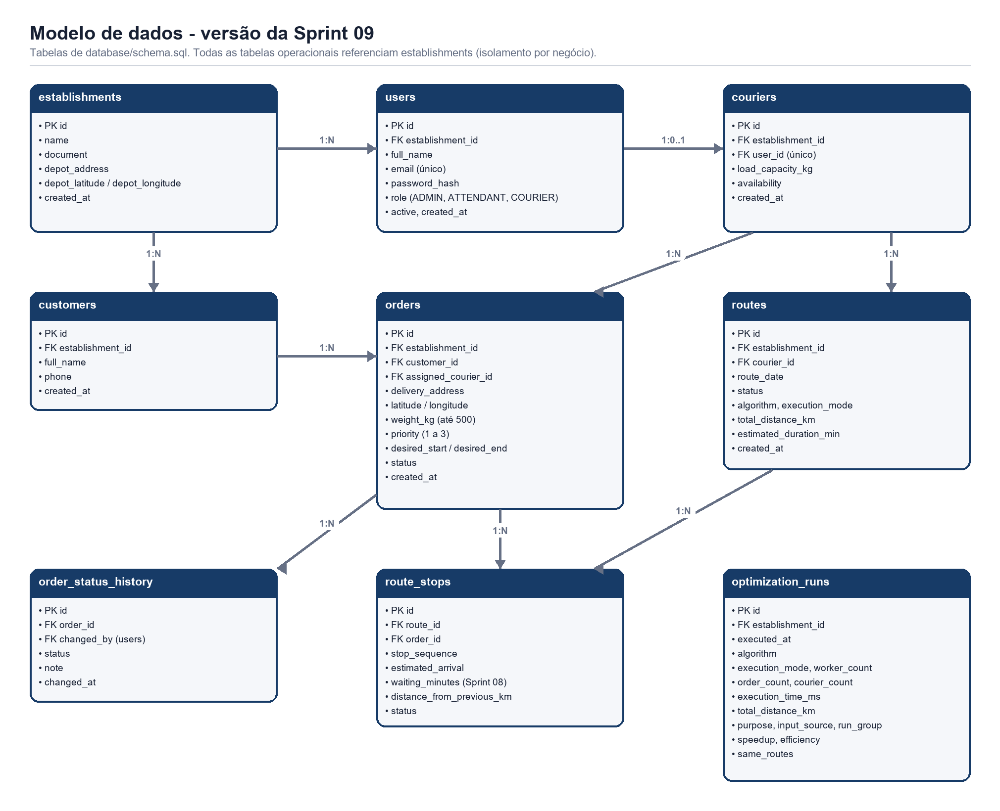

# Documentação final consolidada do RotaCerta

Grupo 04 | Versão 0.11.0-rc.1 | Revisão em 10/11/2026.
Esta referência descreve a implementação preparada na Sprint 11. Os documentos
anteriores permanecem como histórico do planejamento e da evolução.

## 1 Objetivo e produto implementado

O sistema organiza a operação de entregas de pequenos negócios. Autenticação,
clientes, pedidos, entregadores, atribuição, rotas, execução das entregas,
indicadores, histórico e comparação de desempenho estão integrados ao banco.
O público é composto por administrador, atendente e entregador; o cliente final
não acessa uma área própria. As instruções operacionais estão no Manual do
Usuário, e a instalação/manutenção, no Manual Técnico.

## 2 Requisitos funcionais e rastreabilidade

Os identificadores RF01 a RF10 são preservados desde o planejamento. A coluna
abaixo registra como cada requisito se materializou e onde foi verificado.
As referências F, V e N são os casos repetidos na Sprint 11, em
`docs/sprint-11/evidencias/casos_de_teste.json`.

| ID | Implementação vigente | Evidência |
| --- | --- | --- |
| RF01 Autenticação e perfis | Cadastro de negócio, login JWT, usuários, perfis e isolamento por negócio | F01-F03, F11-F12, V01-V03, V20, N01-N08, N16 |
| RF02 Pedidos | Cadastro, edição permitida, consulta, filtros, janela, peso, prioridade e cancelamento com motivo | F07-F10, F18, V06-V11, V14-V15 |
| RF03 Entregadores | Conta de usuário com perfil, capacidade, disponibilidade e controle de acesso ativo | F11-F12, V13, V19 e testes de regras |
| RF04 Rotas otimizadas | Vizinho mais próximo e 2-opt; sequencial, CPU paralela e CUDA opcional | F15, F22; F16 depende de hardware NVIDIA |
| RF05 Atribuição | Manual no pedido e automática por elegibilidade, urgência e carga | F14, suíte test_assignment e concorrência PostgreSQL |
| RF06 Lista e mapa | Rotas com paradas numeradas, trajetos e navegação externa por coordenadas | F15, F17, N06 e capturas atuais |
| RF07 Situação da entrega | Transições controladas e sincronização com paradas/rotas | F17-F18, V11 e test_order_rules/test_routes |
| RF08 Histórico | Situações por pedido e linha do tempo com eventos de pedidos e otimização | F17-F18, F21 e test_history |
| RF09 Relatórios e comparação | CSV operacional filtrado; tempo, distância, speedup e eficiência na área Desempenho | F20-F22, V18, testes de CSV |
| RF10 Painel | Indicadores do negócio, período, alertas e atalhos | F19 e test_dashboard |

O CSV operacional e a comparação do otimizador são recursos diferentes.
O sistema não promete um único arquivo CSV com todas as métricas de benchmark.
CUDA foi demonstrado na Sprint 09 e não reexecutado no hardware ARM desta rodada.

## 3 Requisitos não funcionais e limites da comprovação

| ID | Situação atual | Limite ou validação adicional |
| --- | --- | --- |
| RNF01 Desempenho | Processamento sequencial/paralelo e medições persistidas; igualdade de rotas conferida em CPU | Não há SLA numérico de produção; ganho depende da entrada e da máquina |
| RNF02 Segurança | Argon2, JWT, autorização no backend, isolamento, validação de dados e proteção do CSV | Sem rate limit de login, recuperação por e-mail ou revogação individual de token |
| RNF03 Usabilidade | Formulários com mensagens, foco, confirmações, menus e manual ilustrado | Aceitação com usuário externo continua pendente |
| RNF04 Portabilidade | Interface web e responsividade verificadas no Chrome em computador e celular simulado | Não houve matriz completa de navegadores/dispositivos físicos |
| RNF05 Escalabilidade | Banco relacional e paralelização; ensaio de oito atribuições simultâneas | Não homologado para volume elevado ou combinações de escritas concorrentes |
| RNF06 Confiabilidade | Suíte PostgreSQL, 14 FKs sem órfãos, persistência e ensaio de backup/restauração | Sem solução implementada de alta disponibilidade ou backup automático |
| RNF07 Manutenibilidade | Separação de módulos, testes, manuais, contrato e versionamento | CI de navegador e migrações com revisões formais ainda não implementados |

## 4 Casos de uso finais

Os identificadores UC01 a UC07 também são mantidos. O perfil Atendente passou
a compartilhar com Administrador a geração de rotas e as consultas operacionais;
gestão de usuários e benchmark continuam exclusivos do administrador.

| Caso | Ator e pré-condição | Fluxo e resultado | Alternativas |
| --- | --- | --- | --- |
| UC01 Cadastrar pedido | Administrador/atendente autenticado; cliente existente | Escolher cliente, endereço/local, peso e prioridade; salvar; pedido fica pendente ou atribuído | Campo inválido, raio, janela ou carga impedem salvar e mostram orientação |
| UC02 Cadastrar entregador | Administrador autenticado | Novo usuário, perfil Entregador e capacidade; salvar; conta e registro de entregador criados | E-mail duplicado ou capacidade ausente/inválida recusados |
| UC03 Gerar rotas do dia | Administrador/atendente; ponto de saída e pedidos atribuídos | Escolher modo e gerar; trajetos, paradas e métricas persistidos | Ocupados/fora de serviço podem ser ignorados com motivo; sem elegíveis retorna conflito |
| UC04 Visualizar rota | Entregador ativo com atribuição própria | Abrir Minhas entregas; consultar mapa e sequência; abrir navegação externa | Sem rota mostra situação vazia; não acessa rota de outro entregador |
| UC05 Atualizar entrega | Entregador com pedido próprio atribuído/em rota | Iniciar rota ou saída; confirmar entrega; histórico e parada sincronizados | Pular etapa é recusado; cancelamento/reabertura cabem à gestão |
| UC06 Consultar métricas | Administrador; atendente tem consultas operacionais | Filtrar painel/relatório e, para administrador, executar/consultar benchmark | Período inválido recusado; sem dados mostra estado vazio; CUDA depende de hardware |
| UC07 Autenticar | Qualquer perfil com conta ativa | Informar e-mail/senha; receber sessão e abrir a página permitida | Credenciais inválidas, conta desativada ou sessão expirada recebem tratamento específico |

## 5 Arquitetura e classes implementadas

O frontend recebe interação e prepara as chamadas; o backend decide permissões
e regras; os serviços de domínio coordenam a persistência e o cálculo. As
regras não dependem apenas dos controles visuais. O contrato de 37 operações
está em `docs/api/openapi.json`, acompanhado de guia e catálogo.

O diagrama de classes da Sprint 02 é preservado como planejamento. A referência
acima usa as nove classes realmente mapeadas em `backend/app/models.py`.
Os atributos e associações completos estão no código e no esquema relacional;
os serviços de cálculo e regras ficam em módulos separados, não em métodos
fictícios nas entidades.

## 6 Modelo de dados vigente

O DDL final está em `database/schema.sql`. São nove tabelas e 14 FKs. A inspeção
da Sprint 11 conferiu as colunas com o ORM, PKs, FKs, checks, índices e unicidades.
Não houve nova migração estrutural nesta Sprint. Medidas são NUMERIC, eventos
TIMESTAMPTZ e a data operacional da rota DATE. A API complementa o DDL com
isolamento por estabelecimento, capacidade, raio e regras de transição.

## 7 Regras de negócio consolidadas

| Regra | Comportamento implementado |
| --- | --- |
| RN01 Isolamento | O estabelecimento da conta limita os registros; o entregador consulta somente seus pedidos/rotas |
| RN02 Dados e carga | Pedido com peso maior que zero e até 500 kg; capacidade do entregador maior que zero e até 1.000 kg |
| RN03 Local de entrega | Coordenadas válidas e raio padrão de 30 km quando o ponto de saída está definido |
| RN04 Janela | Nova janela termina no futuro e depois do início; uma janela antiga pode ser preservada para corrigir outros dados |
| RN05 Atribuição automática | Pendentes sem entregador; prioridade/prazo/ID; menor carga/ID entre ativos disponíveis, com capacidade e sem operação em andamento |
| RN06 Concorrência | Bloqueio do estabelecimento serializa atribuição automática no PostgreSQL; o ensaio não cobre todas as escritas |
| RN07 Transições | Pendente, atribuído, em rota e entregue; cancelamento por gestão com motivo; entregador apenas avança suas etapas |
| RN08 Preservação da rota | Após início, dados essenciais e reabertura do pedido têm restrições; novo pedido preserva a trilha anterior |
| RN09 Usuários | Não retirar acesso de entregador com pedidos ativos; não colocar fora de serviço com pedido em rota; não remover o próprio acesso administrativo |
| RN10 Planejamento | Rotas planejadas podem ser substituídas; rotas em andamento permanecem; mudança do ponto de saída é bloqueada com rota ativa |
| RN11 Previsões | Haversine, média de velocidade/atendimento e espera; atraso é sinalizado sem garantia das janelas |
| RN12 Consultas | Período de até 366 dias; relatório até 2.000 linhas e histórico até 500 eventos; CSV é gerado no frontend |
| RN13 Integrações | Busca de endereço indisponível/inválida oferece marcação manual; mapa e navegação externa dependem dos serviços disponíveis |
| RN14 Comparação livre | Até 64 rotas, 500 paradas por rota e 12.000 no total; entrada maior é recusada antes do cálculo |

## 8 Decisões e mudanças em relação ao planejamento

O projeto adotou Python/NumPy para o cálculo de CPU e CUDA C via CuPy para GPU.
A avaliação de C++/OpenMP não se tornou um módulo do produto. O mapa usa
distâncias geográficas, e o adaptador OSRM foi retirado do escopo. As janelas
resultam em previsão/espera/aviso, sem solver que garanta seu atendimento.
Notificações externas e rastreamento GPS ao vivo ficaram fora do escopo.

A exportação implementada é CSV. O PDF cumulativo é material de entrega da
disciplina, produzido pelos roteiros de documentação; não é um relatório PDF
gerado por um botão da aplicação. A distribuição de pedidos é uma etapa
separada da otimização da sequência de cada entregador.

Na Sprint 11, os limites do comparador e a validação da resposta de
geocodificação passaram a constar do contrato atual. O DDL e o algoritmo
principal não foram alterados. Nenhum recurso ainda não implementado é
apresentado nesta documentação como funcionalidade disponível.

## 9 Fontes oficiais da entrega

Manual do Usuário: `docs/manuais/MANUAL_DO_USUARIO.md`.
Manual Técnico: `docs/manuais/MANUAL_TECNICO.md`.
APIs: `docs/api/README.md`, `ENDPOINTS.md` e `openapi.json`.
Revisão e correções: `docs/sprint-11/REVISAO_CODIGO.md`.
Resultados executados: `docs/sprint-11/evidencias`.
Instruções de execução e equipe: `README.md` e `COMO-RODAR.md`.

O índice `docs/README.md` aponta para essas referências. As partes anteriores
do PDF mantêm contexto histórico; a Parte XI descreve esta versão. A equipe
deve atualizar as fontes e repetir os testes afetados antes de qualquer nova
correção posterior à consolidação.
