# Manual do Usuário do RotaCerta

Grupo 04 | UNINASSAU | Ciência da Computação | Turma 8NA | 2026.2.
Versão 1.0.0, revisada em 10/11/2026. As telas capturadas na Sprint 11
continuam representando a mesma interface na versão final.

## 1 Apresentação e público

O RotaCerta ajuda pequenos negócios, como farmácias, mercados e restaurantes,
a organizar suas entregas. Nele, a equipe cadastra clientes e pedidos, escolhe
os entregadores, calcula a ordem das paradas e acompanha cada entrega.

Este manual se destina a administradores, atendentes e entregadores. O cliente
que recebe o pedido não tem uma área de acesso ao sistema. As imagens foram
capturadas na aplicação em funcionamento, com dados de demonstração. Nomes,
números de pedidos, datas e totais podem ser diferentes na sua operação.

Para começar uma operação nova, o administrador deve cadastrar a equipe e
marcar o ponto de saída das entregas. Depois, o fluxo usual é: cadastrar cliente,
cadastrar pedido, atribuir entregador, gerar rota e confirmar a entrega.

## 2 Acesso e autenticação

Abra no navegador o endereço informado pelo responsável pelo sistema. Na
instalação local padrão, use http://localhost:5173. A aplicação e o servidor
precisam estar ligados; a instalação é descrita no Manual Técnico.

1. Digite seu e-mail no campo E-mail.
2. Digite sua senha no campo Senha.
3. Clique em Entrar.
4. Administradores e atendentes chegam à Visão geral; entregadores, a Minhas entregas.

Use as credenciais fornecidas pelo administrador. Os acessos de demonstração
estão identificados no README do projeto e servem apenas ao ambiente de exemplo.

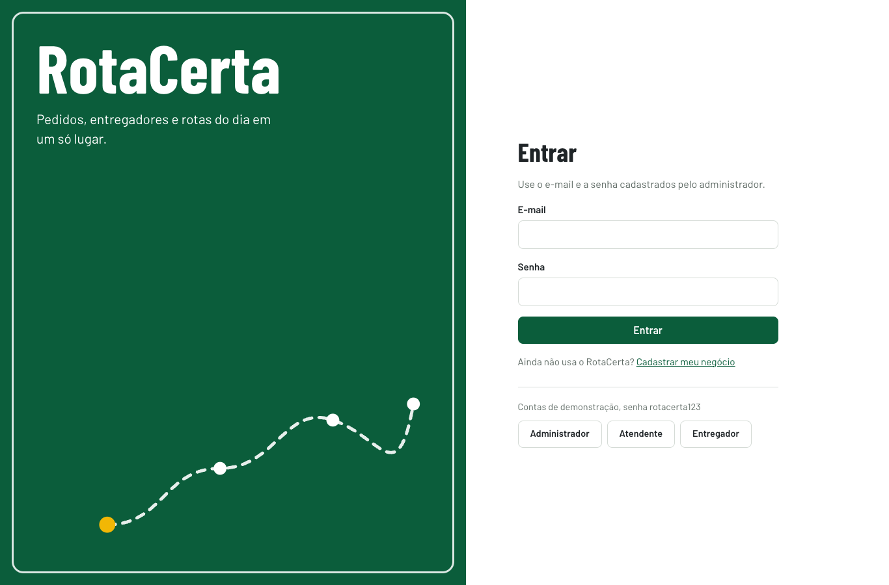

Se você ainda não tem um negócio cadastrado, escolha Cadastrar meu negócio na
tela de entrada. Informe nome do negócio, endereço de saída, seu nome, e-mail
e senha. A senha precisa ter de 8 a 72 caracteres, com letras e números. Clique
em Criar conta. Essa ação cria outro negócio e seu primeiro administrador;
para entrar em uma equipe existente, peça ao administrador que cadastre você.

Para sair, clique em Sair no topo. Se aparecer Sua sessão expirou, entre
novamente; o sistema tentará retornar à página que você estava consultando.
Se esqueceu a senha, solicite ao administrador a alteração do seu usuário.
Não há recuperação de senha por e-mail nesta versão.

## 3 O que cada perfil pode fazer

| Recurso | Administrador | Atendente | Entregador |
| --- | --- | --- | --- |
| Visão geral, clientes, relatórios e histórico | Sim | Sim | Não |
| Cadastrar e editar pedidos abertos | Sim | Sim | Não |
| Atribuir pedidos e gerar rotas | Sim | Sim | Não |
| Excluir pedido ou cliente quando permitido | Sim | Não | Não |
| Gerenciar usuários e ponto de saída | Sim | Não | Não |
| Comparar desempenho do cálculo | Sim | Não | Não |
| Minhas entregas e própria disponibilidade | Não nesta tela | Não nesta tela | Sim |
| Consultar pedido e atualizar entrega própria | Gestão do negócio | Gestão do negócio | Somente pedidos atribuídos a ele |

O menu mostra as opções do seu perfil. Cada negócio acessa seus próprios
dados. Um entregador vê apenas os pedidos atribuídos a ele. Se uma opção não
aparecer ou houver aviso de acesso negado, procure o administrador.

## 4 Navegação e leitura das telas

No computador, use os itens abaixo da marca RotaCerta. A seção atual fica
destacada. No celular, toque em Menu, escolha a seção e o menu será recolhido.
Use os links acima dos formulários para voltar à lista ou ao pedido.

Tabelas largas podem ser deslizadas para o lado dentro de sua própria área.
Em Clientes, isso permite alcançar Novo pedido, Editar e Excluir. A página
continua ajustada à largura do celular. Alterações só são gravadas ao clicar
no botão de salvar ou confirmar; Cancelar abandona o formulário.

Pedidos e Minhas entregas consultam atualizações a cada 15 segundos com a aba
visível. A hora da última atualização aparece na tela. Clique em Atualizar agora
quando precisar conferir imediatamente. Relatórios e histórico usam Aplicar filtros.

## 5 Preparar a equipe e o ponto de saída

Como administrador, abra Usuários e clique em Novo usuário. Preencha nome,
e-mail e senha e escolha Administrador, Atendente ou Entregador. Para entregador,
informe capacidade de carga maior que zero e de até 1.000 kg. Salve o cadastro.
Entregadores novos começam disponíveis.

Em Usuários, Editar permite corrigir os dados, o perfil e a capacidade. Para
trocar uma senha, preencha Nova senha; deixe o campo vazio para preservar a
atual. Desativar retira o acesso, preservando os registros. Reativar permite
acesso novamente. O administrador não pode desativar o próprio usuário.

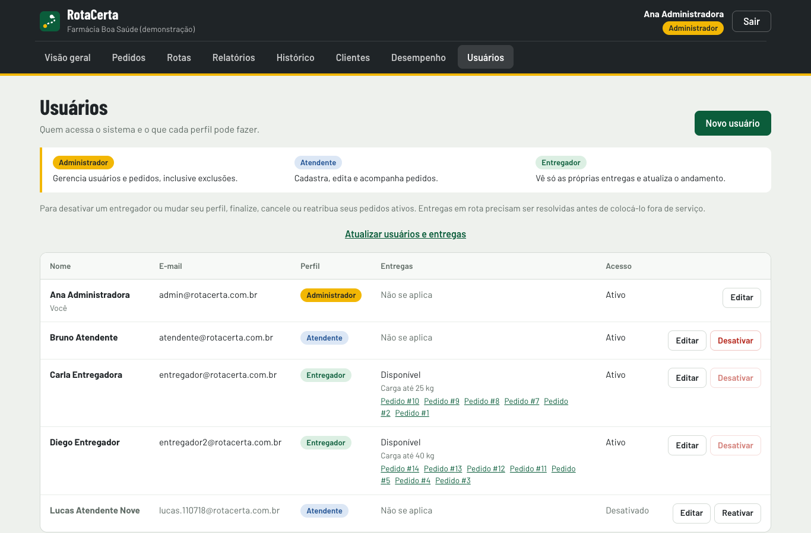

Antes de desativar ou retirar o perfil de um entregador, resolva seus pedidos
atribuídos e em rota. A tela mostra links para os pedidos ativos. Para colocar
fora de serviço, primeiro resolva os pedidos em rota. A capacidade não pode
ficar abaixo da carga dos pedidos ativos.

Em Rotas, o administrador configura o endereço e a posição do ponto de saída
no mapa. Use a busca ou clique na posição correta e salve. As rotas saem e
retornam a esse ponto. Uma alteração substitui os planejamentos ainda não
iniciados; enquanto houver rota em andamento, o sistema impede a troca.

## 6 Cadastrar e consultar clientes

1. Abra Clientes e clique em Novo cliente.
2. Informe Nome e, se desejar, Telefone com DDD.
3. Clique em Cadastrar cliente.
4. Confira a mensagem de cadastro e o cliente na lista.

A busca aceita nome ou telefone. Editar permite corrigir os dados. Novo pedido,
na linha do cliente, abre o formulário com o cliente selecionado. O último
endereço usado pode vir preenchido; confirme se é o endereço desta entrega.

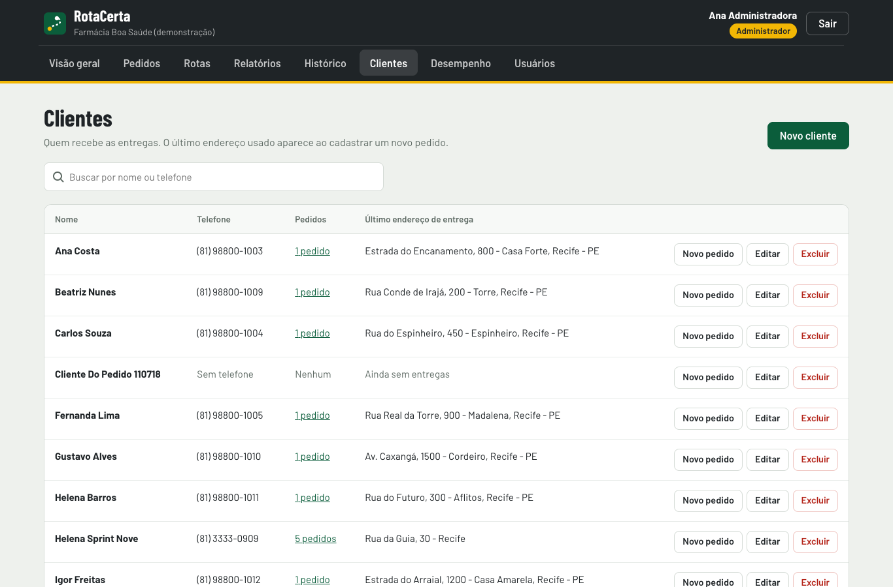

Não é permitido cadastrar novamente a mesma combinação de nome e telefone.
Somente o administrador pode excluir um cliente, e apenas quando ele não tem
pedidos vinculados. Para um cliente com histórico, mantenha o cadastro.

## 7 Cadastrar um pedido

Abra Pedidos e clique em Novo pedido. Os campos obrigatórios são cliente,
endereço, local no mapa e peso. Role o formulário para alcançar as demais seções.

1. Escolha o cliente. Se ainda não existir, clique em Cadastrar cliente; ao salvar, você volta ao pedido.
2. Informe rua, número, bairro e cidade em Endereço.
3. Clique em Buscar endereço, escolha um resultado e confirme o ponto no mapa. Você também pode marcar o local diretamente no mapa ou preencher latitude e longitude.
4. Informe o peso em kg, maior que zero e de até 500 kg.
5. Escolha prioridade Alta, Normal ou Baixa.
6. Se necessário, preencha Entregar a partir de e Entregar até. Um novo fim deve estar no futuro e depois do início.
7. Escolha Quem vai entregar ou deixe Sem entregador por enquanto.
8. Clique em Cadastrar pedido e confira os dados na página do pedido.

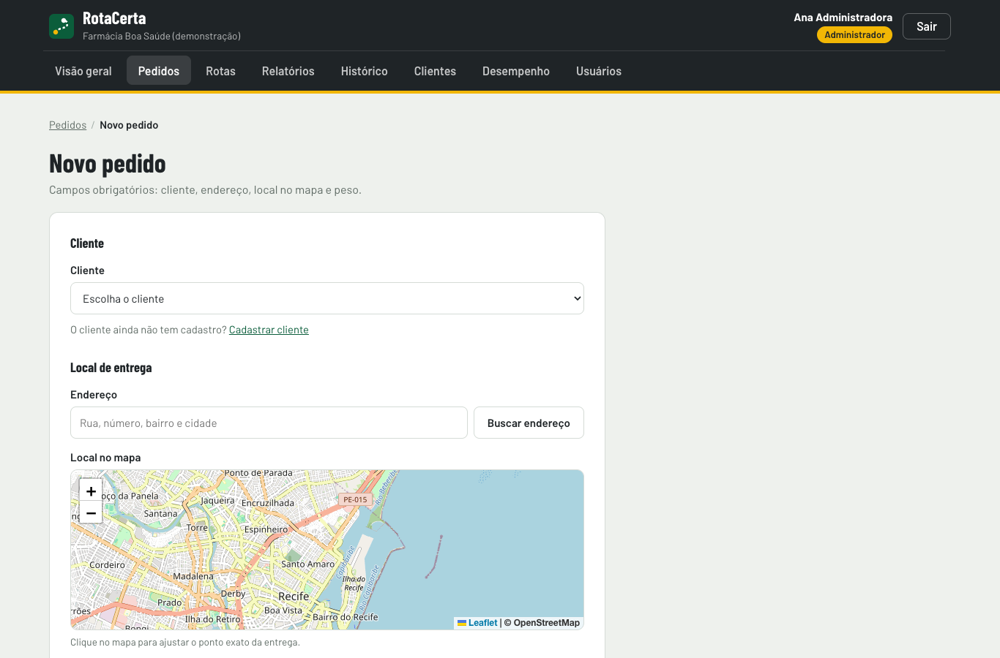

A busca de endereço é uma ajuda: verifique número, complemento e posição antes
de salvar. Se a busca estiver indisponível, a mensagem orienta a marcar o mapa.
O limite padrão de entrega é 30 km a partir do ponto de saída, quando ele está
definido. Um entregador fora de serviço ou sem capacidade não pode receber o pedido.

Um pedido sem entregador fica Pendente. Ao atribuir um entregador, ele passa a
Atribuído. A capacidade considera os pedidos atribuídos e em rota. Prioridade e
horários orientam a operação; a rota calcula distância e não garante todos os prazos.

## 8 Consultar editar e cancelar pedidos

Em Pedidos, use a busca por cliente, telefone, endereço, entregador ou número e
os filtros de situação. Clique no número do pedido para abrir seus dados,
localização e histórico. Cada mudança de situação informa o responsável e o horário.

Clique em Editar pedido para corrigir um pedido aberto e depois em Salvar
alterações. Pedidos entregues ou cancelados não podem ser editados diretamente.
Depois da saída para entrega, não é permitido trocar cliente, entregador,
endereço, posição ou peso de uma entrega pertencente a uma rota iniciada.
Para uma nova entrega com outros dados, cadastre outro pedido.

Para cancelar, clique em Cancelar pedido, informe o motivo e confirme. O motivo
deve ter pelo menos cinco caracteres úteis. O cancelamento fica no histórico.
A exclusão é exclusiva do administrador e pode ser impedida pelo vínculo a uma
rota iniciada; nesse caso, use o cancelamento quando ele for permitido.

O fluxo usual é Pendente, Atribuído, Em rota e Entregue. Atribuídos podem voltar
a pendentes pela gestão; encerrados só podem ser reabertos quando as regras
da rota permitem. Reabrir remove a atribuição e volta a Pendente. Uma rota já
iniciada ou concluída impede essa reabertura para preservar seu histórico.

## 9 Atribuir os pedidos automaticamente

1. Confira se existem entregadores ativos, disponíveis e com capacidade.
2. Em Pedidos, clique em Atribuir automaticamente.
3. Leia a confirmação e clique em Atribuir pedidos.
4. Confira o resumo de atribuídos e não atribuídos e seus motivos.
5. Acesse Rotas para calcular os trajetos dos pedidos atribuídos.

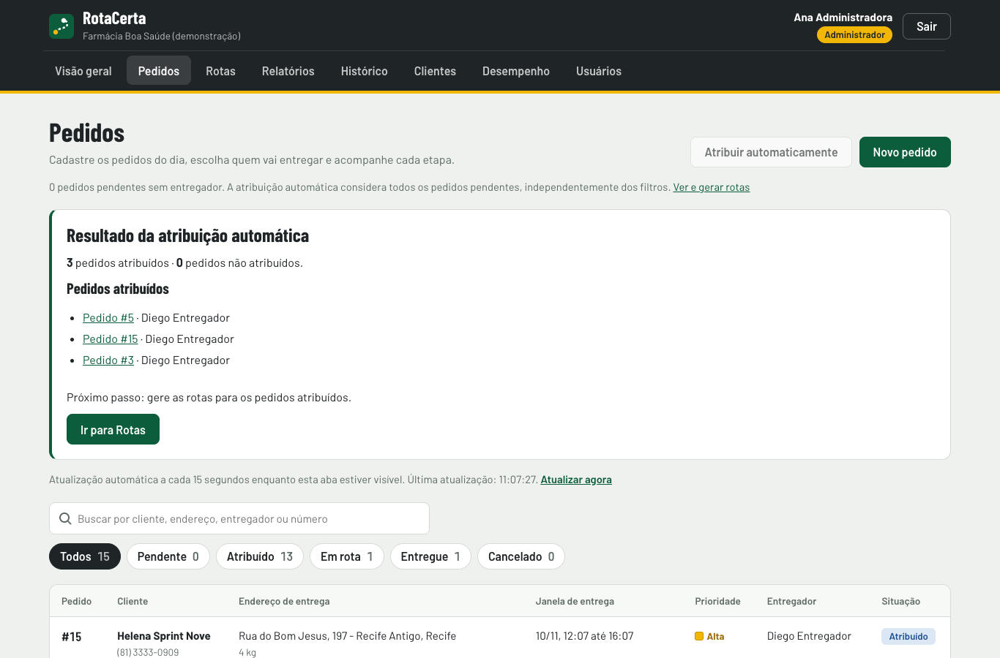

A ação considera todos os pedidos pendentes sem entregador, inclusive os
ocultos por filtros. A escolha avalia prioridade, prazo e capacidade. Quem está
com rota ou pedido em andamento fica fora da seleção automática. Um pedido
fora do raio, com prazo vencido ou sem entregador elegível permanece pendente,
com o motivo. Revise o pedido ou a disponibilidade antes de tentar novamente.

Para atribuição manual, abra o pedido, escolha Editar pedido e selecione Quem
vai entregar. Salve. As validações de capacidade e acesso continuam valendo.

## 10 Gerar e consultar rotas

Abra Rotas depois da atribuição. Confira o ponto de saída, escolha Sequencial
ou Paralelo em CPU e clique em Gerar rotas. O modo GPU só fica disponível em
máquina compatível. Confira a quantidade de rotas geradas, as paradas, a distância
e a duração prevista. O mapa usa uma cor para cada entregador e números nas paradas.

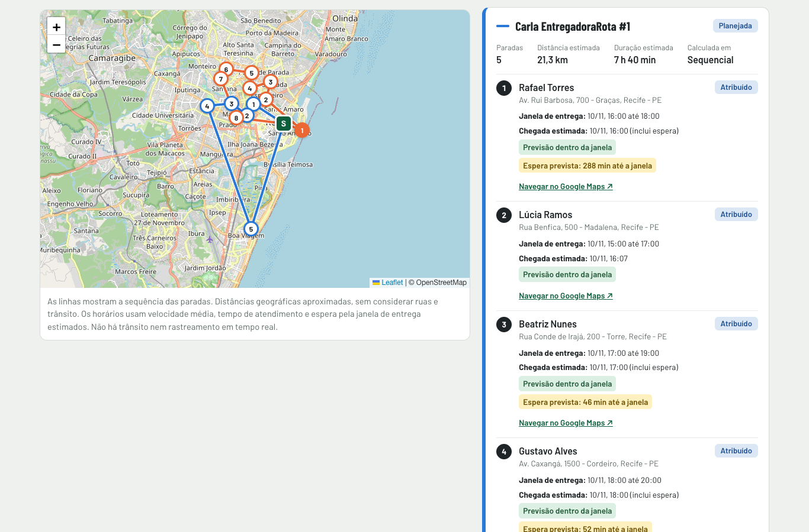

Gerar novamente substitui rotas ainda planejadas; rotas em andamento são
preservadas. Pedidos novos de um entregador ocupado aguardam a próxima rota.
O sistema explica quando algum entregador não entrou na geração.

O mapa liga as posições geográficas, sem acompanhar ruas ou trânsito. As
previsões usam velocidade média e tempo de atendimento. Espera prevista indica
o tempo até o início da janela; atraso previsto indica risco de ultrapassar o
fim. Esses avisos ajudam a equipe a agir, mas não garantem o horário de chegada.

## 11 Executar a entrega pelo celular

Entre com a conta do entregador. Minhas entregas apresenta somente os seus
pedidos. Confira sua disponibilidade, a rota e a sequência das paradas.

1. Fique Disponível para receber novos pedidos.
2. Quando a rota estiver pronta e você for sair, toque em Iniciar rota.
3. Siga as paradas. O botão de navegação abre o Google Maps em outra aba quando disponível.
4. Abra o pedido da parada e confira endereço e cliente.
5. Após entregar, toque em Confirmar entrega.
6. Confira a situação Entregue. Repita nas próximas paradas.

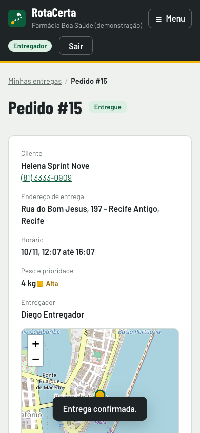

Iniciar rota coloca seus pedidos em Em rota. Quando todas as paradas estiverem
resolvidas, a rota é encerrada. Para pedidos atribuídos sem rota gerada, a tela
também permite avançar a saída para entrega e a confirmação na ordem correta.
O entregador não cancela nem reabre pedidos: peça apoio à gestão quando houver problema.

Fora de serviço impede o recebimento de novos pedidos; essa alteração é bloqueada
se houver entrega em rota. Se sua lista parecer desatualizada, use Atualizar agora.
No fim do uso em aparelho compartilhado, toque em Sair.

## 12 Usar a Visão geral e os relatórios

Administradores e atendentes usam Visão geral para acompanhar pedidos,
entregadores, rotas e alertas. Escolha as datas e clique em Atualizar painel.
Os atalhos levam ao cadastro de pedidos, ao planejamento e às consultas.

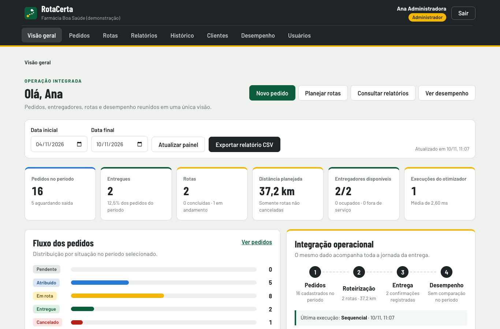

Em Relatórios, escolha período, busca, situação, entregador ou prioridade e
clique em Aplicar filtros. A lista e os totais passam a representar esse resultado.
Clique em Exportar CSV para baixar as mesmas linhas. O arquivo pode ser aberto
em uma planilha; usa ponto e vírgula como separador. Não há exportação em XLSX.

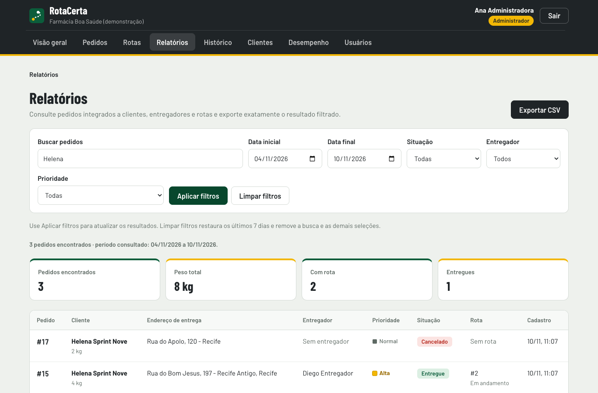

Limpar filtros volta aos últimos sete dias e remove as demais seleções. Um
período pode ter até 366 dias. A consulta retorna até 2.000 pedidos; para volumes
maiores, divida as datas. Se uma entrega não aparecer, confira o período e a
situação antes de concluir que o cadastro foi perdido. Os limites diários da
consulta são definidos em UTC; amplie as datas ao conferir registros perto da meia-noite.

## 13 Consultar o histórico operacional

Abra Histórico, escolha período e, se desejar, tipo da operação, situação do
pedido e termo de busca. Clique em Aplicar filtros. A linha do tempo reúne
mudanças de situação de pedidos e execuções do cálculo de rotas, com horário,
responsável e observação. Ela não é um registro de todas as ações da aplicação.

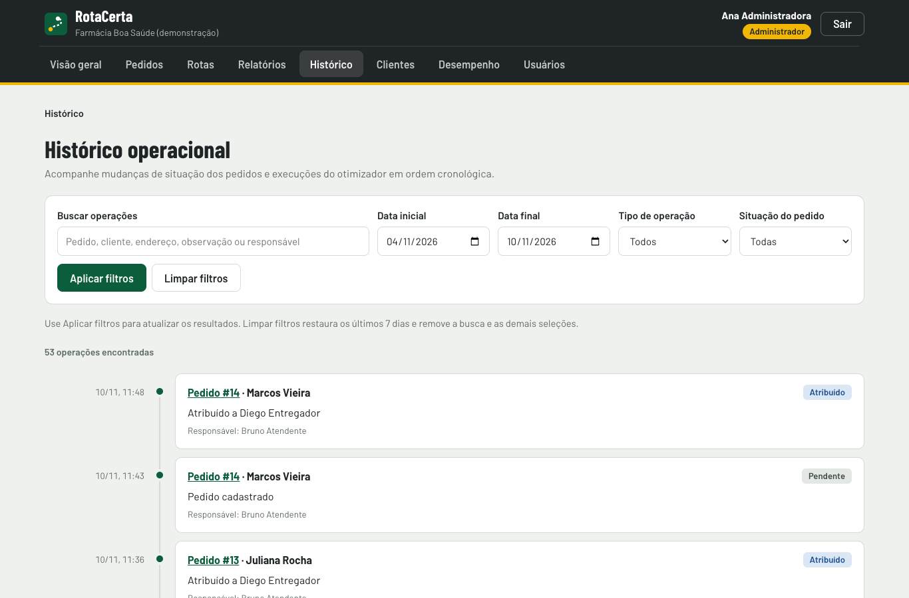

A situação filtra eventos de pedidos; para consultar cálculos do otimizador,
deixe esse filtro sem uma situação de pedido. A lista apresenta até os 500
eventos mais recentes do resultado. Reduza o período se precisar localizar
eventos anteriores. Limpar filtros restaura a consulta padrão.

## 14 Comparar o desempenho do cálculo

Somente o administrador acessa Desempenho. Essa tela compara formas de
executar o mesmo cálculo; ela não confirma entregas nem cria pedidos fictícios
na operação. A entrada sintética serve apenas para os experimentos.

1. Escolha Instância sintética ou Pedidos atribuídos.
2. Na sintética, informe entregadores, paradas por entregador e semente.
3. Escolha a quantidade de processos de CPU e as repetições.
4. Inclua GPU apenas quando a tela informar que ela está disponível.
5. Clique em Executar comparação e aguarde a conclusão.
6. Confira os tempos, o gráfico e se as sequências são idênticas.

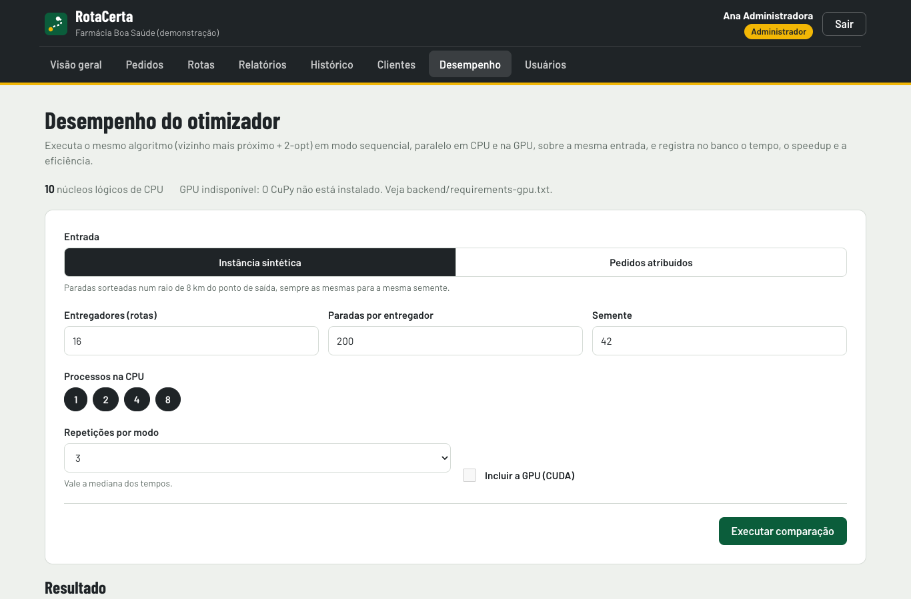

Speedup acima de 1 indica execução mais rápida que a sequencial; abaixo de 1,
mais lenta. Eficiência compara o ganho com o número de processos de CPU.
Poucos pedidos podem não compensar o custo de distribuir o trabalho.
Semente igual e mesma configuração permitem repetir a mesma entrada sintética.
O resultado de uma máquina não é uma promessa de desempenho em outra.

## 15 Mensagens e situações comuns

| Mensagem ou situação | Como proceder |
| --- | --- |
| E-mail ou senha inválidos | Confira os dados; peça ao administrador para verificar sua conta. |
| Usuário desativado | Solicite a reativação ao administrador. |
| Sua sessão expirou | Entre novamente; confirme em qual conta está acessando. |
| Corrija os campos destacados | Leia cada mensagem, ajuste os campos e salve novamente. |
| Busca de endereço indisponível | Marque o local diretamente no mapa e mantenha o endereço completo. |
| Capacidade de carga excedida | Escolha outro entregador ou reorganize os pedidos; não informe um peso incorreto. |
| Prazo já passou ou janela inválida | Informe uma nova janela futura; ao corrigir outro dado, uma janela antiga pode ser preservada. |
| Nenhum pedido atribuído aguardando rota | Atribua pedidos antes de gerar, ou confira se já pertencem a uma rota. |
| A atribuição mudou | Atualize a lista e gere o planejamento novamente quando permitido. |
| Não é possível desativar entregador | Resolva os pedidos ativos indicados na tela. |
| Nenhum resultado encontrado | Reveja busca, período e demais filtros; use Limpar filtros. |
| Não foi possível falar com o servidor | Confira a conexão e peça ao responsável para verificar se a aplicação está ligada. |

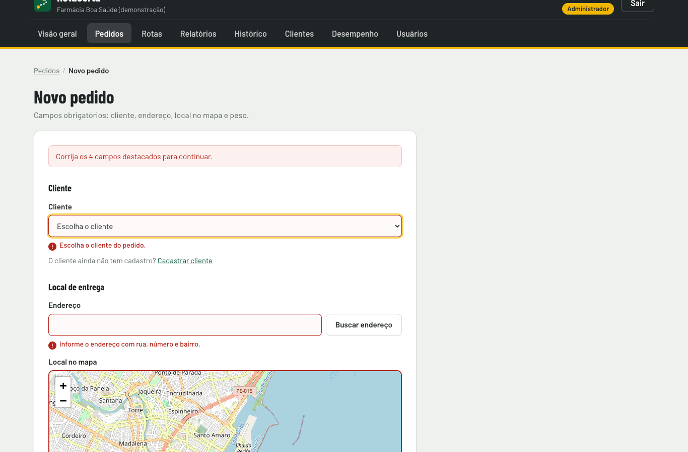

Se o problema continuar, informe ao administrador a tela, o número do pedido,
o horário e o que tentou fazer. Não compartilhe sua senha. A versão não envia
mensagens por WhatsApp, SMS ou e-mail e não oferece rastreamento ao vivo por GPS.

## 16 Roteiro rápido para o primeiro uso

O administrador cadastra um entregador disponível e define o ponto de saída.
O atendente cadastra um cliente e um pedido com local próximo desse ponto,
sem janela de horário para simplificar o primeiro exercício. Depois atribui o
pedido e gera a rota. O entregador entra em outra sessão do navegador, inicia
a rota e confirma a entrega. A gestão retorna ao pedido e ao histórico para
conferir o resultado e exporta o relatório do período.

Esse roteiro pode orientar o treinamento de uma pessoa nova. A validação de
aceitação com usuário externo deve ser registrada pela equipe; as capturas
deste manual são da verificação técnica automatizada.
