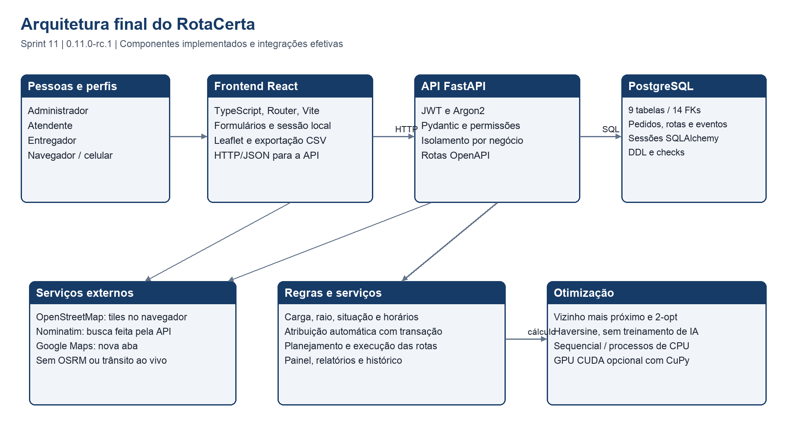
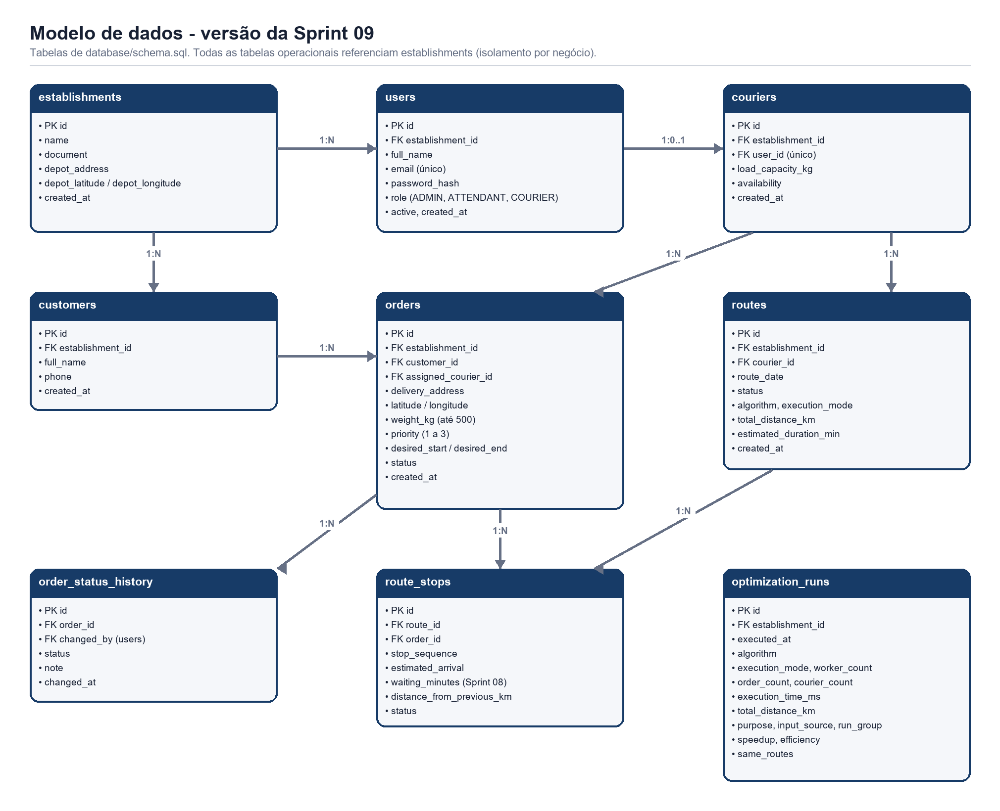

# Manual Técnico do RotaCerta

Grupo 04 | UNINASSAU | Ciência da Computação | Turma 8NA | 2026.2.
Versão 1.0.0, revisada em 10/11/2026.

## 1 Visão geral da solução

O RotaCerta é uma aplicação web para organizar entregas de pequenos negócios.
O frontend React consulta uma API HTTP FastAPI. A API autentica a conta,
aplica regras de negócio e usa SQLAlchemy para persistir dados em PostgreSQL.
O estabelecimento da conta delimita os dados operacionais; entregadores têm
acesso restrito aos próprios pedidos e rotas.

O núcleo de otimização calcula sequências de paradas por vizinho mais próximo
e 2-opt. Ele pode executar sequencialmente, em processos de CPU ou em GPU CUDA.
O sistema não contém modelo de IA treinado, serviço de LLM ou pipeline de
aprendizado de máquina: seu componente computacional é uma heurística de otimização.



O mapa usa Leaflet e tiles do OpenStreetMap. A API consulta Nominatim para
sugerir posições de endereços. O Google Maps é aberto pelo navegador para
navegação externa. Nenhum desses serviços participa do cálculo das distâncias
do otimizador; não há OSRM ou trânsito em tempo real na versão entregue.

## 2 Tecnologias e dependências

| Camada | Tecnologias da versão |
| --- | --- |
| Frontend | React 19.1.1, TypeScript 5.9.2, Vite 7.3.7 no lockfile, React Router 7.18.4, Leaflet 1.9.4 |
| API | Python, FastAPI 0.116.1 e Uvicorn 0.35.0 |
| Persistência | SQLAlchemy 2.1.1, psycopg 3.3.6, PostgreSQL 16+ |
| Autenticação | PyJWT 2.15.0, Argon2 com argon2-cffi 25.1.0 |
| Validação e HTTP | Pydantic, pydantic-settings 2.10.1, email-validator 2.3.0, httpx 0.28.1 |
| Cálculo | NumPy 2.5.3; CuPy CUDA opcional em requirements-gpu.txt |
| Evidências e documentos | Playwright, pypdf, ReportLab e Pillow em requirements-docs.txt |

Os arquivos de referência são `backend/requirements.txt`, `requirements-gpu.txt`,
`requirements-docs.txt` e `frontend/package-lock.json`. O lockfile do frontend
deve ser usado com `npm ci`. Dependências transitivas Python não têm um lockfile
completo; ao reproduzir medições, registre também as versões efetivamente instaladas.

## 3 Organização dos módulos

| Caminho | Responsabilidade |
| --- | --- |
| backend/app/main.py | Aplicação FastAPI, ciclo de vida, roteadores, tratamento de erros e health check |
| backend/app/config.py e database.py | Configuração, engine/sessões, DDL inicial e atualizações incrementais |
| backend/app/models.py e schemas.py | Mapeamento relacional e contratos de entrada/saída |
| backend/app/security.py | Hash e verificação de senha, JWT e dependências de autorização |
| backend/app/routers | Autenticação, usuários, clientes, pedidos, atribuição, rotas, consultas e desempenho |
| backend/app/rules.py e assignment.py | Regras, carga ativa, raio e atribuição automática transacional |
| backend/app/planning.py | Geração, agendamento, sincronização e execução das rotas |
| backend/app/reporting.py e benchmark.py | Indicadores, relatórios, histórico e medições de desempenho |
| backend/app/optimizer | Núcleo numérico, processos CPU e kernel CUDA opcional |
| frontend/src/App.tsx, session.tsx e api.ts | Rotas da interface, sessão, comunicação HTTP e adaptação de erros |
| frontend/src/pages e components | Telas por módulo, formulários, mapas, confirmações e navegação |
| backend/tests e frontend/src/*.test.mjs | Testes de regras, API, navegação, validação e utilitários |
| tools e tools/documentation | Ambientes locais, casos de navegador e geração de documentos |
| database, docs e output/pdf | DDL, manuais/documentação e PDFs cumulativos |

## 4 Requisitos do ambiente

Use Python 3.12 ou superior, Node.js 20.19+ ou 22.12+, npm, Git e PostgreSQL 16+.
O sistema é acessado em navegador moderno. Google Chrome é necessário para
os roteiros de evidência, não para todo uso normal. Internet é necessária para
instalar dependências e carregar mapa/busca externa. Sem GPU NVIDIA, os modos
sequencial e paralelo em CPU continuam disponíveis.

O Compose é a alternativa para subir os três serviços sem instalar o PostgreSQL
e o Python diretamente no host. Ele usa uma imagem PostgreSQL 16, API Python
3.12 e frontend Node 22. O serviço frontend do Compose usa Vite em modo de
desenvolvimento para a demonstração acadêmica; não é um pacote de hospedagem
de produção com proxy, HTTPS e distribuição de arquivos estáticos.

## 5 Obter o código e preparar a instalação manual

Na raiz de um terminal Bash em macOS ou Linux:

```bash
git clone https://github.com/alvccpj/rota-certa.git
cd rota-certa
git switch --detach v1.0.0
python3 -m venv backend/.venv
source backend/.venv/bin/activate
pip install -r backend/requirements.txt
npm ci --prefix frontend
cp backend/.env.example backend/.env
cp frontend/.env.example frontend/.env
```

A branch identifica esta entrega; após sua integração, a `master` também passa
a contê-la. Se o repositório já existe, use `git fetch origin` e selecione a
branch correspondente sem substituir alterações locais não salvas.

No PowerShell, crie o ambiente com `python -m venv backend/.venv` e ative com
`backend\.venv\Scripts\Activate.ps1`; execute os mesmos comandos pip e npm.
O guia `COMO-RODAR.md` traz as variações completas de terminal.

## 6 Banco de dados e configuração local

Crie um usuário de aplicação e um banco no PostgreSQL usando pgAdmin ou psql.
Use uma senha própria, definida fora do repositório. Pelo psql, conectado com
permissão administrativa, substitua o nome de exemplo se necessário:

```sql
CREATE ROLE rotacerta_app LOGIN;
\password rotacerta_app
CREATE DATABASE rotacerta OWNER rotacerta_app;
```

Execute CREATE DATABASE separadamente de uma transação. O comando `\password`
pede a senha sem incluí-la na linha SQL do manual. Não copie marcadores como
`<SENHA>` literalmente para uma configuração final.

Edite `backend/.env` com a conexão do seu ambiente, no formato:

```text
DATABASE_URL=postgresql+psycopg://<USUARIO>:<SENHA>@<HOST>:<PORTA>/<BANCO>
JWT_SECRET=<CHAVE_ALEATORIA_PRIVADA>
SEED_DEMO_DATA=true
```

Codifique caracteres reservados de usuário/senha para uso em URL. Guarde `.env`
somente no ambiente de execução; ele é ignorado pelo Git. Os `.env.example`
existentes contêm valores públicos de desenvolvimento, não credenciais de um
serviço real. Substitua-os antes de disponibilizar uma instalação com dados reais.
O frontend recebe apenas o endereço público da API em `VITE_API_URL`, nunca um segredo.

Na primeira inicialização, a API aplica `database/schema.sql` em PostgreSQL
sem a tabela `users`. Depois, cria tabelas incrementais e aplica as alterações
previstas em `database.py`. Se `SEED_DEMO_DATA=true` e não houver estabelecimento,
cria os dados acadêmicos de exemplo. Para começar sem exemplos, use `false` e
cadastre um negócio pela interface.

## 7 Variáveis de ambiente

| Variável | Uso e orientação |
| --- | --- |
| DATABASE_URL | Conexão SQLAlchemy; segredo se incluir senha; necessária para o banco escolhido |
| JWT_SECRET | Chave privada de assinatura HS256; defina uma chave aleatória e não a publique |
| ACCESS_TOKEN_MINUTES | Validade da sessão; padrão 480 minutos |
| CORS_ORIGINS | Origens do frontend separadas por vírgula; padrão localhost/127.0.0.1 na porta 5173 |
| AUTO_CREATE_SCHEMA | Habilita criação/atualizações previstas no início; padrão true |
| SEED_DEMO_DATA | Dados de demonstração no banco vazio; padrão true no ambiente acadêmico |
| SCHEMA_PATH | Caminho alternativo do DDL, se o arquivo não estiver no caminho padrão do projeto |
| MAX_DELIVERY_RADIUS_KM | Raio de operação a partir do ponto de saída; padrão 30 km |
| AVERAGE_SPEED_KMH | Velocidade média da previsão; padrão 25; configure um valor positivo |
| SERVICE_MINUTES_PER_STOP | Atendimento por parada; padrão 5 minutos; use valor não negativo |
| LOCAL_UTC_OFFSET_HOURS | Deslocamento do dia operacional das rotas; padrão -3 |
| GEOCODER_URL | Endpoint de busca de endereços; padrão Nominatim/OpenStreetMap |
| GEOCODER_USER_AGENT | Identificação HTTP da aplicação ao geocodificador |
| VITE_API_URL | Endereço da API acessível ao navegador; padrão http://localhost:8000 |
| POSTGRES_DB, POSTGRES_USER, POSTGRES_PASSWORD | Banco, usuário e senha do serviço db no Compose |
| POSTGRES_PORT, API_PORT, FRONTEND_PORT | Portas publicadas pelo Compose; padrões 5432, 8000 e 5173 |

O backend lê `.env` a partir do diretório de trabalho. Por isso, na execução
manual, inicie Uvicorn dentro de `backend`. Variáveis exportadas no processo
prevalecem sobre o arquivo. O Vite lê a configuração ao iniciar ou compilar;
reinicie após mudar `frontend/.env`. Uma instalação com portas diferentes também
precisa ajustar CORS e o endereço da API no navegador.

## 8 Executar sem Docker

Terminal 1, na raiz e com o ambiente virtual ativo:

```bash
cd backend
uvicorn app.main:app --host 127.0.0.1 --port 8000
```

Terminal 2, na raiz:

```bash
cd frontend
npm run dev -- --host 127.0.0.1 --port 5173
```

Abra http://localhost:5173 e confira http://localhost:8000/health. A resposta
normal inclui `status: ok` e `database: connected`. Se o banco falhar, o health
check retorna 503. A documentação interativa fica em `/docs` e `/redoc` na API.
Use Ctrl+C para encerrar os servidores. Para desenvolvimento, é possível usar
`--reload` no Uvicorn. O build é gerado por `npm run build --prefix frontend`;
`npm run preview --prefix frontend` permite inspecioná-lo localmente.

Para uma demonstração SQLite, após instalar as dependências, execute
`python tools/run_local_demo.py`. Os dados ficam em `backend/rotacerta-demo.db`.
Esse modo não comprova os checks e bloqueios do PostgreSQL; a validação final
do banco usa o PostgreSQL real.

## 9 Executar com Docker Compose

Na raiz, copie `.env.example` para `.env`, revise os valores locais e execute:

```bash
docker compose config --quiet
docker compose up --build
```

O primeiro comando verifica a configuração; o segundo constrói e inicia db,
api e frontend. O banco aplica o DDL na criação inicial do volume. A API usa
`db` como host dentro da rede Compose; o navegador precisa de um endereço
acessível pelo host, como localhost. Aguardar o health check do banco faz parte
da inicialização.

`docker compose down` mantém o volume. `docker compose down -v` apaga os dados
e só deve ser usado para reiniciar um ambiente descartável. O YAML foi validado
na Sprint 11; a subida dos containers não foi reexecutada nesta rodada. A
execução e os testes atuais foram realizados na instalação manual PostgreSQL.

## 10 Modelo relacional e atualizações



| Tabela | Papel e integridade principal |
| --- | --- |
| establishments | Negócio e ponto de saída; referência para o isolamento operacional |
| users | Usuários por negócio; e-mail único global; senha em hash e perfil |
| couriers | Entregador por usuário único, negócio, capacidade e disponibilidade |
| customers | Clientes do negócio, com nome e telefone opcional |
| orders | Cliente, entregador opcional, endereço, posição, peso, prioridade, janela e situação |
| order_status_history | Situação do pedido, observação, autor e instante; cascade na exclusão do pedido |
| routes | Entregador, negócio, data, situação, algoritmo, modo e métricas |
| route_stops | Pedido único por parada e sequência única por rota; cascade na exclusão da rota |
| optimization_runs | Execuções por negócio, origem, grupo, tempo, distância, speedup e eficiência |

As PKs são BIGSERIAL, as referências BIGINT, medidas NUMERIC, eventos
TIMESTAMPTZ e a data da rota DATE. O DDL possui checks de situações, perfis,
modos, pesos/capacidades positivos, prioridade, janela, espera e métricas.
Os índices atendem pedidos por negócio/situação e entregador, histórico,
rotas por entregador/data e otimizações por modo/grupo.

O PostgreSQL é a fonte de referência do esquema; `models.py` mapeia suas
entidades, mas nem todas as restrições do DDL estão declaradas no ORM.
As FKs não garantem sozinhas que duas entidades pertencem ao mesmo negócio;
a API aplica essa regra. A inspeção atual compara tabelas/colunas, lê as
restrições e procura órfãos e relações entre negócios diferentes.

Na Sprint 11 não houve alteração no banco. Atualizações históricas contemplam
o histórico de pedidos, métricas/modo GPU e `waiting_minutes`. Não há ferramenta
de migração com revisões, como Alembic, nem rollback automático. Antes de
alterar o DDL ou inicializar uma base antiga, faça backup e valide em cópia.

## 11 APIs e tratamento de erros

O contrato OpenAPI e o catálogo estão em `docs/api`. São 37 operações HTTP,
sem prefixo `/api`. Corpos usam JSON; respostas 204 não têm corpo. `PUT`
recebe um modelo completo. O login recebe e-mail/senha e retorna token Bearer;
a API confere ativação e perfil no banco em cada requisição.

Os grupos são `/auth`, `/users`, `/couriers`, `/customers`, `/orders`,
`/establishment/depot`, `/routes`, `/optimizer`, `/dashboard`, `/geocode` e
`/health`. O catálogo lista métodos, parâmetros, modelos e perfis. Há exemplos
completos em `docs/api/README.md`; o Swagger permite testar com Authorize.

401 indica sessão inválida, 403 falta de acesso, 404 registro inexistente/não
visível, 409 conflito de negócio e 422 entrada inválida. `/health` e `/geocode`
podem retornar 503. O frontend mostra mensagens e associa validações aos campos.
Resposta inválida do geocodificador também é tratada como indisponibilidade.

`POST /optimizer/compare` é público, não persiste e usa entrada livre limitada
a 64 rotas, 500 paradas por rota e 12.000 no total. `/optimizer/benchmark`
é restrito ao administrador e persiste medições. Relatórios retornam JSON;
o frontend produz o CSV, com escape de aspas e neutralização de prefixos de fórmula.

Datas das janelas devem ser enviadas em ISO 8601 com fuso; sem fuso são
interpretadas como UTC. Relatório e histórico usam intervalos diários em UTC,
com datas inclusivas e limite de 366 dias. O período padrão vai de seis dias
antes até hoje do servidor. A data operacional da rota usa o deslocamento
configurado. Esses critérios precisam ser considerados em consultas perto
da meia-noite; não há seleção individual de fuso na interface.

O relatório retorna até 2.000 linhas, o histórico até 500 eventos, e o histórico
do otimizador aceita limite entre 1 e 500. Não há paginação geral das listas.

## 12 Componente de otimização e desempenho

Para cada entregador, a entrada inclui depósito e pedidos atribuídos. A matriz
de distâncias usa Haversine. O vizinho mais próximo constrói a sequência inicial;
2-opt inverte trechos quando reduz a distância, com desempate determinístico.
O trajeto inclui a volta ao depósito. A heurística não garante o ótimo global.

No modo sequencial, o processo calcula uma rota por vez. Em CPU paralela,
`ProcessPoolExecutor` distribui rotas independentes, reutilizando um pool por
vez protegido por lock. O pool é aquecido nas comparações; threads BLAS por
processo são limitadas para evitar excesso de paralelismo.

No modo CUDA, CuPy compila um RawKernel com NVRTC; cada rota usa um bloco de
256 threads para matriz, seleção de vizinhos e trocas 2-opt. A GPU é opcional,
detectada por `/optimizer/capabilities`. A instalação específica está em
`backend/requirements-gpu.txt`; requer NVIDIA e suporte ao CUDA correspondente.
A Sprint 11 não revalidou esse modo no hardware ARM utilizado.

O benchmark registra mediana dos tempos, número efetivo de processos,
distância e igualdade de rotas. Speedup é tempo sequencial dividido pelo tempo
do modo; eficiência CPU é speedup dividido pelos processos. A eficiência GPU
não é apresentada como se fosse eficiência de processos. Transferência e
preparação podem tornar a GPU mais lenta em entradas pequenas.

O agendamento posterior usa velocidade média, atendimento e espera até a
janela. Não altera a ordem para garantir todos os prazos. A atribuição automática
prioriza urgência/prazo e balanceia carga elegível; não é uma otimização conjunta
completa de frota e janelas.

## 13 Testes e reprodução das evidências

Ative o ambiente virtual e execute da raiz:

```bash
python -m unittest discover backend/tests -v
npm test --prefix frontend
npm run build --prefix frontend
pip install -r backend/requirements-docs.txt
```

Para a mesma suíte no PostgreSQL, configure `TEST_DATABASE_URL` com a conexão
do banco de teste. Cada caso recria somente o schema
`rotacerta_testes_automatizados`. Não execute suítes concorrentes que usem
esse mesmo schema. Os testes de atribuição usam uma barreira e oito chamadas
simultâneas, conferindo carga e histórico no PostgreSQL real.

Para os 61 casos de navegador, configure `POSTGRES_URL` para um banco de teste
e inicie o ambiente descartável:

```bash
python tools/run_test_environment.py --schema sprint11_testes --api-port 8021 --web-port 5191
```

Em outro terminal, com o mesmo ambiente virtual ativo:

```bash
python tools/documentation/capture_sprint11_evidence.py
python tools/documentation/export_api_docs.py --evidence-dir docs/sprint-11/evidencias
```

O ambiente recria `sprint11_testes`. O roteiro usa API 8021 e frontend 5191;
as variáveis `API_URL`, `APP_URL` e `EVIDENCE_DIR` permitem outro destino.
Com `DATABASE_URL` apontando ao mesmo schema e `API_URL` à porta 8021,
execute a inspeção sem alterar a base:

```bash
python tools/documentation/verify_release.py --evidence-dir docs/sprint-11/evidencias
```

O contrato exportado deve ser idêntico ao servido. As evidências ficam em
`docs/sprint-11/evidencias` e as capturas em `assets`. O teste CUDA é dispensado
sem GPU; concorrência PostgreSQL é dispensada na rodada SQLite. A ausência de
uma falha não equivale à homologação de carga ou à aceitação com usuários externos.

## 14 Proteção das informações e operação

Senhas de contas são armazenadas com Argon2; JWT usa HS256 e expiração.
O navegador guarda a sessão no armazenamento local, sem refresh token.
Sair remove a sessão do navegador, mas não revoga antecipadamente uma cópia
de token ainda válida. Desativar a conta impede novas chamadas autenticadas.

Configure chave própria, acesso ao banco e origens antes de usar dados reais.
Uma publicação precisa de HTTPS, controle de acesso à infraestrutura e política
de backups. O projeto não oferece, nesta versão, limitação de tentativas de
login, recuperação de senha por e-mail ou proteção completa contra abuso de
requisições. Os limites do comparador não substituem controles de infraestrutura.

Não registre tokens, senhas ou URLs privadas completas em logs, issues ou PDFs.
O log de criação do seed deixou de exibir a senha nesta Sprint. Arquivos `.env`,
ambientes virtuais, bases SQLite, node_modules, dist e tmp são ignorados pelo Git.
As credenciais dos exemplos históricos são públicas e restritas à demonstração;
nenhuma credencial de serviço real deve ser incluída em uma entrega.

## 15 Backup e restauração

Use as ferramentas PostgreSQL com os parâmetros do ambiente autorizados.
Defina `DB_HOST`, `DB_PORT`, `DB_USER` e `DB_NAME` localmente, sem gravar senha
no repositório. O cliente pode solicitar a senha ou usar um arquivo de acesso
protegido do operador. Exemplo de backup na raiz:

```bash
mkdir -p tmp/backups
pg_dump -h "$DB_HOST" -p "$DB_PORT" -U "$DB_USER" \
  --format=custom --no-owner --no-acl --file=tmp/backups/rotacerta.dump "$DB_NAME"
```

Teste a restauração em um banco novo, sem substituir o banco da operação:

```bash
createdb -h "$DB_HOST" -p "$DB_PORT" -U "$DB_USER" rotacerta_validacao_restore
pg_restore -h "$DB_HOST" -p "$DB_PORT" -U "$DB_USER" \
  --no-owner --no-acl --dbname=rotacerta_validacao_restore tmp/backups/rotacerta.dump
```

Confira tabelas, contagens e uma consulta da aplicação antes de considerar o
backup utilizável. Armazene cópias em local protegido e defina retenção com
o responsável pela operação. O diretório tmp é ignorado e não substitui uma
política de backup. O ensaio desta Sprint utilizou somente o banco descartável.

## 16 Manutenção e continuidade

Parta da branch principal atualizada, crie uma branch curta e preserve o padrão
dos módulos. Acrescente regra no backend, exponha-a pelo roteador e reflita os
erros no formulário. Toda correção funcional deve ter teste que reproduza o
problema. Para uma alteração de schema, mantenha DDL, modelos e estratégia de
atualização coerentes e valide instalação nova e base anterior em cópias.

Antes do pull request, rode a suíte afetada, build e verificações necessárias.
Atualize README, manuais, contrato e documentação final quando mudar comportamento.
Use `export_api_docs.py` para regenerar as APIs. Não grave novas evidências
em pastas de Sprints encerradas; use `--evidence-dir` ou `EVIDENCE_DIR`.

O PDF da Sprint 11 é reconstruído por `tools/documentation/build_sprint11_document.py`.
As imagens e manuais são fontes versionadas; renderize o PDF e revise as páginas
antes da entrega. O histórico das Sprints anteriores deve permanecer preservado.
Siga `CONTRIBUTING.md` para commits e revisão por outro integrante.

## 17 Diagnóstico básico

| Sintoma | Verificação recomendada |
| --- | --- |
| Health check 503 | Conferir PostgreSQL, conexão, schema e logs do backend |
| Navegador sem conexão com a API | Conferir VITE_API_URL, porta da API, CORS e reiniciar o Vite |
| Tabelas ausentes em base nova | Conferir permissões, AUTO_CREATE_SCHEMA e caminho de schema.sql |
| Rota não gerada | Conferir ponto de saída, pedidos atribuídos, carga, disponibilidade e rota em andamento |
| Busca de endereço falha | Conferir serviço externo; o usuário pode marcar o mapa manualmente |
| GPU indisponível | Consultar capabilities e documentação do modo CUDA; usar CPU enquanto isso |
| Resultado não aparece no relatório | Conferir período UTC, filtros e limite de linhas |
| Testes PostgreSQL interferem entre si | Encerrar outra suíte que esteja recriando o mesmo schema descartável |

Registre versão, cenário e mensagem ao abrir uma correção. Use dados fictícios
para reproduzir. Escalabilidade com grande volume, combinações de escritas
concorrentes e aceitação externa continuam exigindo validações específicas.

## 18 Versão final e congelamento

A versão 1.0.0 mantém os módulos e o modelo relacional descritos neste manual.
A nova verificação está em `docs/sprint-12/evidencias`; as capturas da Sprint 11
continuam ilustrando as mesmas telas. Consulte `docs/sprint-12/CODE_FREEZE.md`
para reprodução por tag, integridade e procedimento de correção crítica.
O PDF cumulativo atual é produzido por `tools/documentation/build_sprint12_document.py`.
