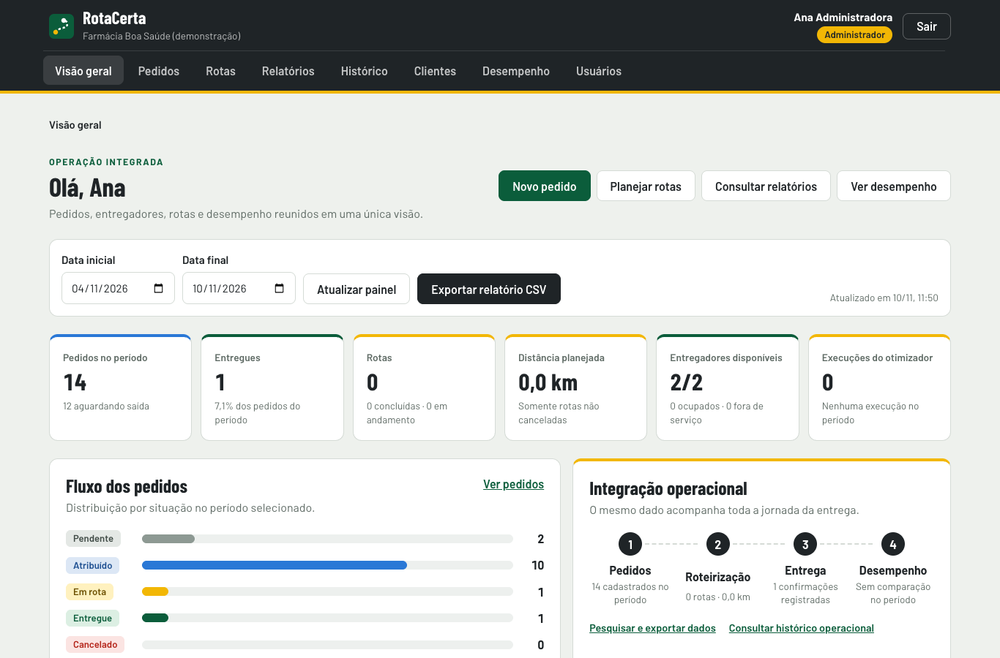
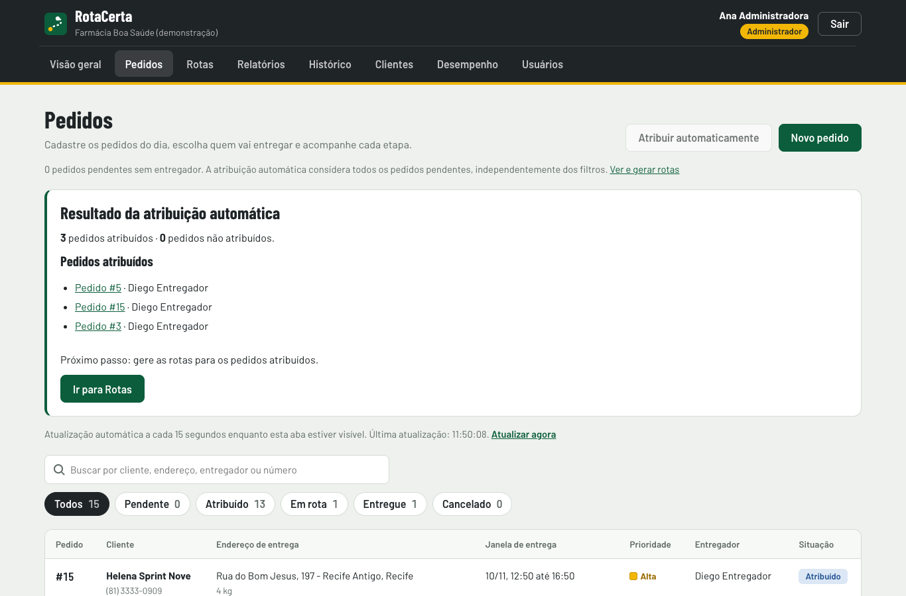
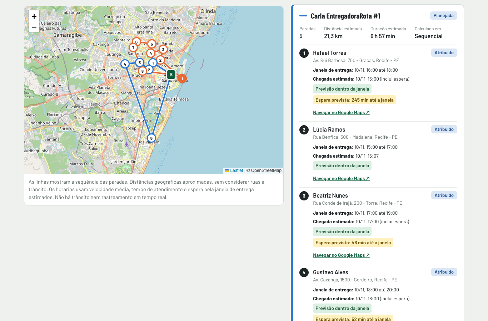
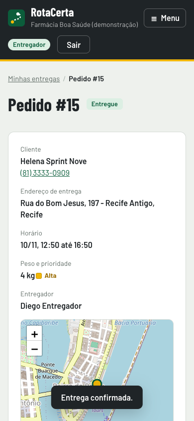
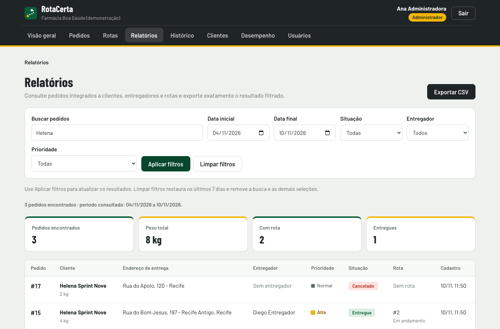

# Sprint 12 Versão final do sistema

**Grupo 04 - RotaCerta | UNINASSAU | Ciência da Computação | Turma 8NA | 2026.2**

Consolidação em 10/11/2026. Prazo: **28/11/2026 às 23h59**, horário de Recife.
Versão final **1.0.0**, identificada pela tag **v1.0.0**, preparada na branch
`codex/sprint-12-versao-final`, a partir da master `15feac9`, com a Sprint 11 integrada.
Repositório: https://github.com/alvccpj/rota-certa

## 1 Identificação da equipe

| Integrante | Matrícula | Responsabilidade inicial registrada |
| --- | --- | --- |
| Álvaro Jordão | 01748200 | Scrum Master e Product Owner; organização e priorização |
| Arthur Sales | 01593811 | Backend, otimização e paralelização |
| Vinícius Trigueiro | 01794959 | Frontend, banco e documentação |
| William Coelho de Morais | 01263977 | Desenvolvimento e testes |
| Guilherme de Luna Barros | 01615925 | Desenvolvimento e validação |

A identificação mantém o padrão histórico. Responsabilidades e falas propostas
não comprovam participação efetiva de pessoas nesta execução. Somente o Scrum
Master Álvaro Jordão realiza o envio do documento no Teams em nome da equipe.

## 2 Descrição da versão final

O RotaCerta organiza entregas de pequenos negócios locais. A versão 1.0.0 integra
autenticação e perfis, cadastro de clientes/usuários/entregadores, pedidos,
atribuição automática por elegibilidade e capacidade, geração de rotas,
execução pelo entregador, painel, relatório/CSV, histórico e comparação de
processamento. O frontend React/TypeScript acessa a API FastAPI e persiste no
PostgreSQL. O componente avançado implementa vizinho mais próximo e 2-opt,
com execução sequencial, paralela em CPU e modo CUDA opcional.

O fluxo operacional foi executado sobre banco real e dados de demonstração,
sem mocks nos módulos essenciais. O benchmark usa carga sintética explicitamente
identificada para medir o mesmo algoritmo; a geração de rotas operacionais usa
pedidos persistidos. Não há modelo de IA treinado: o componente é de otimização
e processamento paralelo, conforme o escopo do projeto.

Nesta Sprint não foram acrescentadas novas funcionalidades ou tabelas. A
versão candidata foi revalidada, o ensaio revelou um erro de navegação nos mapas,
a correção foi aplicada e as verificações afetadas foram repetidas antes do
congelamento. O desenvolvimento de novos recursos fica encerrado nesta entrega.

## 3 Correspondência às entregas obrigatórias

| Exigência | Resultado e material | Situação |
| --- | --- | --- |
| Sistema final | Módulos integrados, PostgreSQL, CPU e fluxos reais verificados | Concluído no escopo executado |
| Correções | Histórico BUG-01 a BUG-12 preservado; BUG-13 reproduzido/corrigido e regressões passando | Sem bloqueio conhecido nos cenários cobertos |
| Code Freeze | Versão 1.0.0, tag v1.0.0, manifesto e política de correção crítica | Registro nesta Parte XII |
| Dois vídeos | Roteiros completos 16:9 e 9:16, sequência visual e divisão proposta | Planejamento entregue; gravação pendente |
| Teste da apresentação | Ensaio técnico automatizado completo, com tempo, persistência e comparação | Técnica executada; falas humanas pendentes |
| Documento único | Sprints 01 a 11 preservadas e Parte XII anexada | PDF cumulativo identificado pelo grupo/projeto |

O planejamento atende à modalidade permitida para os vídeos nesta Sprint. Já o
ensaio humano completo com integrantes não foi realizado nesta sessão e permanece
uma pendência explícita. O ensaio técnico não é apresentado como participação
ou aprovação da equipe.

## 4 Verificação da versão final

Ambiente macOS ARM64, Python 3.14.7 e PostgreSQL 17.10 em cluster separado.
Bateria principal no schema descartável `sprint12_testes`, API 8022 e frontend
5192. Ensaio em `sprint120_testes`, portas 8023/5193. Chrome via Playwright,
localidade pt-BR e fuso America/Recife. Os registros estão em `evidencias` e as
capturas em `assets` desta Sprint.

| Verificação | Resultado da versão final | Evidência |
| --- | --- | --- |
| Backend SQLite | 159 descobertos: 156 aprovados, 3 dispensados | testes_backend_sqlite.txt |
| Backend PostgreSQL | 159 descobertos: 158 aprovados, 1 dispensado | testes_backend_postgresql.txt |
| Frontend | 55 aprovados; nenhuma falha | testes_frontend.txt |
| Navegador | 60 aprovados; nenhuma falha; 1 não executado | casos_de_teste.json |
| Responsividade | 320, 390 e 768 px sem overflow; ações acessíveis | interface_rc.json |
| Regressão BUG-13 | 15 navegações; zero erros JavaScript após a correção | regressao_mapas.json |
| Produção frontend | TypeScript e Vite concluídos | build.txt |
| Dependências npm | Zero vulnerabilidades reportadas na rodada | auditoria_npm.json |
| Banco e contrato | Nove tabelas, 14 FKs sem órfãos e 37 operações sincronizadas | banco_e_contrato.json |
| Backup | Nove tabelas restauradas e todas as linhas comparadas | backup_restauracao.json |
| Compose | Configuração válida; containers não iniciados nesta rodada | compose.txt |
| Ensaio técnico | Oito etapas aprovadas; pedido entregue e comparação CPU | ensaio_tecnico.json |
| Organização | Links locais, arquivos atuais e padrões explícitos verificados | organizacao_github.json |

O teste CUDA é dispensado no backend e F16 não é executado no navegador por
incompatibilidade de hardware. No SQLite, dois testes de concorrência PostgreSQL
também são dispensados. Os totais distinguem testes descobertos de aprovados.
A execução histórica com NVIDIA na Sprint 09 permanece no documento anterior;
não foi repetida nem atribuída a esta máquina.

A suíte PostgreSQL inclui os testes de atribuição simultânea da Sprint 10;
o backend também cobre as validações externas da Sprint 11. A regressão de
CSV continua incluída nos 55 testes de frontend. Não houve falha nas execuções
finais. O arquivo `regressao_mapas_antes.json` é intencionalmente reprovado:
ele documenta a reprodução anterior à correção, e não uma falha da versão final.

## 5 Evidências dos módulos em funcionamento

O login identifica o perfil e controla os menus. A bateria F01-F22 verifica
cadastros, pesquisa, edição/exclusão, validações de pedidos, atribuição, rotas,
entrega, cancelamento, indicadores, relatório, histórico e comparação CPU.
Os casos V01-V20 e N01-N19 verificam validação e navegação, incluindo permissões
e isolamento entre estabelecimentos. O catálogo registra procedimento, resultado
esperado, resultado obtido e captura associada a cada caso aplicável.

As imagens são evidências complementares da aplicação executada. A demonstração
funcional continua reproduzível pelos roteiros; as imagens não representam
funcionalidades futuras nem substituem a execução exigida pela disciplina.

## 6 Banco final, API e instruções de execução

A estrutura final permanece composta por establishments, users, couriers,
customers, orders, order_status_history, routes, route_stops e optimization_runs.
O DDL e os modelos ORM foram conferidos quanto ao conjunto de tabelas/colunas,
PKs, FKs, checks, unicidades e índices. Os 14 relacionamentos foram verificados
sem órfãos, e quatro consultas de coerência entre estabelecimentos retornaram zero
inconsistências. Outra sessão autenticada e outra conexão SQL leram os mesmos
IDs e situações dos 19 pedidos do estabelecimento de demonstração após a bateria.

O backup do schema final foi gerado em formato custom e restaurado em outro
banco descartável, `rotacerta_s12_restore_final`. Todas as linhas das nove tabelas
foram comparadas em ordem de ID e registradas por contagem e SHA-256, sem incluir
um dump com dados no repositório. O esquema público de desenvolvimento não foi
alterado. Não foi necessária migração estrutural nesta Sprint.

Documentação de API: https://github.com/alvccpj/rota-certa/blob/v1.0.0/docs/api/README.md

Contrato OpenAPI: https://github.com/alvccpj/rota-certa/blob/v1.0.0/docs/api/openapi.json

README da entrega: https://github.com/alvccpj/rota-certa/blob/v1.0.0/README.md

As 37 operações incluem autenticação, perfis, parâmetros, corpos e respostas no
contrato exportado; o guia traz exemplos. Com a API local no ar, `/docs` e `/redoc`
permitem consulta interativa. O contrato exportado foi comparado ao servido pela
API 1.0.0. README, COMO-RODAR e Manual Técnico mantêm instalação, requisitos,
configuração do banco, comandos e estrutura. Os dois manuais completos continuam
incorporados na Parte XI; os ajustes desta versão são descritos nesta Parte XII.

## 7 Registro das correções e ajustes

| Registro | Problema tratado | Evidência da situação final |
| --- | --- | --- |
| BUG-01 a BUG-04 | Texto vazio, fusos mistos, ID excessivo e caractere nulo | Casos V14-V17 e regressões backend |
| BUG-05/06 | Mensagem de ID inválido e retorno ao destino após login | N01-N03/N11 e testes frontend |
| BUG-07 a BUG-09 | Fuso do seed, aviso de sessão expirada e menu | Suítes dos dois bancos e navegação N15/N19; histórico detalhado na Sprint 09 |
| BUG-10 | Overflow horizontal em tabela de clientes no celular | Verificações atuais em 320/390/768 px |
| BUG-11 | Resposta externa de geocodificação inválida | Testes de estrutura, campos e coordenadas continuam passando |
| BUG-12 | CSV com fórmula precedida por espaços | Regressões de exportação frontend passando |
| BUG-13 | Zoom do Leaflet terminava após remover o mapa e gerava erro JavaScript | Dez erros reproduzidos antes; zero nas mesmas 15 navegações após a correção |

O BUG-13 foi corrigido desativando a animação CSS de zoom nos componentes
MapPicker e RouteMap. Marcação, zoom, mapas e reenquadramento continuam
funcionando; a troca de telas deixa de disputar o callback de animação com a
desmontagem. A causa e o roteiro de regressão estão no registro do ensaio.

Outros ajustes foram de preparação: versão 1.0.0 em backend/frontend/OpenAPI,
destino explícito no auditor do repositório para preservar evidências históricas,
novo executor de ensaio, manifesto de código, roteiros e atualização do índice.
Não se declara garantia de inexistência de defeitos fora dos cenários executados.

## 8 Congelamento, vídeos e apresentação

A referência estável é v1.0.0. O registro Code Freeze, incluído a seguir, descreve
reprodução por tag, integridade dos arquivos e regras para correções críticas.
Novos recursos ficam fora desta versão. Não mover a tag após a publicação;
qualquer correção necessária deve gerar outra versão identificável e revalidada.

O planejamento dos vídeos também está integralmente incluído: horizontal 16:9,
máximo de dez minutos, roteiro com orçamento de 9min30s e explicação do problema,
solução, arquitetura, tecnologias, fluxo e otimização; vertical 9:16 de cerca de
45s, proposta criativa, cortes e marcações @pryscillabgoncalves e @antenorparnaiba.
Gravação, edição, revisão de áudio e publicação dependem da equipe.

O ensaio técnico executou a sequência inteira de ambiente, cadastro, atribuição,
rota, entrega, relatório, histórico e comparação. O pedido #15 atravessou as
quatro situações e foi entregue pelo usuário correto. O tempo técnico foi de
9,791s sem falas; os 9min30s são planejados, não um tempo humano medido.
A distribuição de falas inclui os cinco integrantes e está apresentada como proposta.

## 9 Pendências e ajustes finais

| Pendência | Como concluir | Responsável proposto |
| --- | --- | --- |
| Ensaio humano completo | Reunir os integrantes, confirmar falas e cronometrar a execução na máquina final | Scrum Master e equipe |
| Aceitação externa | Executar roteiro do Manual do Usuário com pessoa externa e registrar resultado | Equipe |
| Vídeos finais | Gravar os dois formatos, editar e revisar; horizontal até dez minutos | Equipe |
| CUDA, se demonstrado | Revalidar v1.0.0 com NVIDIA e registrar ambiente/resultados | Backend e otimização |
| Revisão e Teams | Conferir o PDF e anexar somente o documento cumulativo até 28/11 às 23h59 | Álvaro Jordão |

Continuam limites explícitos do produto: distâncias geográficas sem ruas/trânsito,
sem GPS ao vivo ou notificações externas, estimativas sem garantia de janela,
heurística sem ótimo global, exportação CSV e dependências de rede para tiles e
geocodificação. CPU atende à execução essencial sem NVIDIA. Homologação de carga
alta, outros navegadores e infraestrutura de produção com HTTPS/rate limit/alta
disponibilidade permanecem fora da validação desta entrega.

## 10 Reprodução e entrega

Usar `tools/documentation/capture_sprint12_evidence.py` com a API e o frontend no
ambiente isolado da Sprint 12. O ensaio usa `rehearse_sprint12.py` e outra base;
a regressão específica usa `verify_map_navigation.py`. Conferir o congelamento
com `verify_code_freeze.py`. Os passos e os limites de cada roteiro constam nos
registros incluídos a seguir.

O gerador `tools/documentation/build_sprint12_document.py` preserva as páginas
2 a 208 do PDF anterior, atualiza a capa e acrescenta a Parte XII a partir da
página 209. A Parte XI continua contendo os manuais completos, requisitos,
diagramas e revisão da Sprint 11. As partes históricas mantêm os resultados e
pendências registrados à época; para a versão atual, prevalece a Parte XII.

Arquivo de entrega: `output/pdf/Grupo_04_RotaCerta_Sprints_01_a_12.pdf`.
Somente Álvaro Jordão deve anexá-lo no Teams; não enviar Sprints ou manuais em
arquivos separados. O envio no Teams não foi realizado nesta execução.
